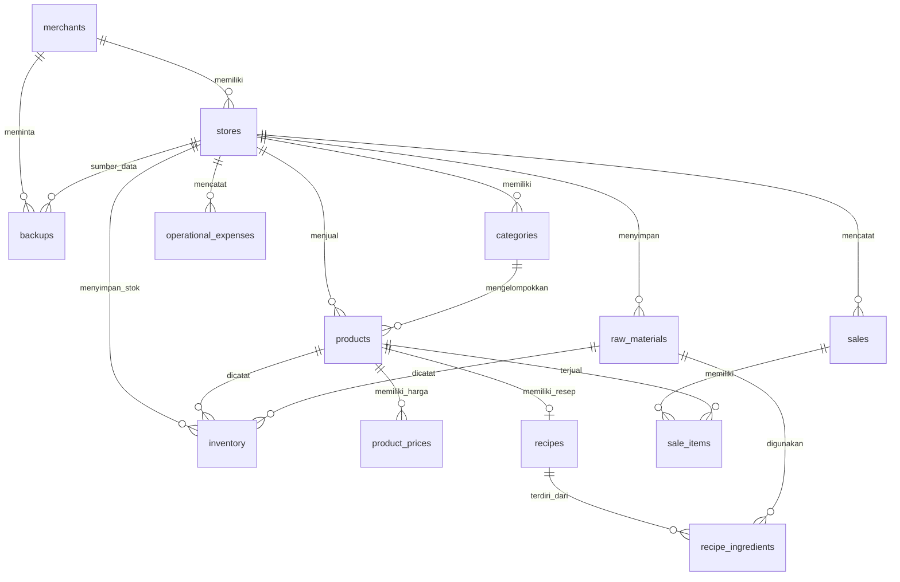

<p align="center">
  
</p>

<h1 align="center">SuperPOS</h1>

<p align="center">
  Aplikasi Point of Sale (POS) dan manajemen usaha untuk UMKM frozen food —
  mulai dari kasir, HPP, stok bahan baku, laporan keuangan, sampai backup data.
</p>

<p align="center">
  
  
  
  
</p>

---

## Daftar Isi

- [Tentang](#tentang)
- [Fitur Utama](#fitur-utama)
- [PWA (Install ke Perangkat)](#pwa-install-ke-perangkat)
- [SEO & Metadata](#seo--metadata)
- [Teknologi](#teknologi)
- [Struktur Proyek](#struktur-proyek)
- [Skema Database](#skema-database)
- [Memulai](#memulai)
- [Perintah](#perintah)
- [Alur Penggunaan](#alur-penggunaan)
- [Perhitungan HPP](#perhitungan-hpp)
- [Backup, Ekspor & Impor](#backup-ekspor--impor)
- [Rute Aplikasi](#rute-aplikasi)
- [Batasan & Catatan](#batasan--catatan)
- [Troubleshooting](#troubleshooting)
- [Lisensi](#lisensi)

---

## Tentang

**SuperPOS** adalah aplikasi POS berbasis web yang dirancang untuk UMKM, khususnya
usaha frozen food. Aplikasi ini membantu pemilik usaha mengelola lebih dari satu
toko/cabang, menghitung Harga Pokok Penjualan (HPP), memproses transaksi kasir,
mencetak struk, serta memantau laba rugi.

Karakteristik utama:

- **Multi-cabang** — satu akun pemilik dapat memiliki beberapa toko.
- **HPP dua mode** — perhitungan rinci per bahan baku atau akumulasi total modal.
- **Kasir terintegrasi** — katalog, keranjang, diskon, pembayaran, dan struk.
- **Laporan keuangan** — penjualan, HPP, biaya operasional, laba kotor, dan laba bersih.
- **Backup & restore** — ekspor/impor data dalam format Excel (`.xlsx`).
- **Berbasis cloud** — data disimpan di Supabase (PostgreSQL + Storage + Auth).

Seluruh antarmuka menggunakan Bahasa Indonesia dan dioptimalkan untuk desktop
maupun perangkat mobile.

---

## Fitur Utama

### 🔐 Autentikasi & Akun

- Registrasi akun dengan nama pemilik, nomor telepon, nama toko, email, password,
  dan logo toko.
- Pembuatan **PIN pemulihan 6 digit** saat registrasi (disimpan sebagai hash
  `bcrypt`, dilengkapi pembatasan percobaan dan masa lockout).
- Login dengan email dan password.
- Lupa password melalui verifikasi PIN pemulihan.
- Ganti password dari halaman pengaturan (password lama atau PIN pemulihan).
- Halaman **Welcome/Onboarding** saat aplikasi pertama kali dibuka.

### 🏪 Multi-Toko / Cabang

- Satu merchant dapat memiliki banyak cabang.
- **Switch toko aktif** — seluruh halaman otomatis mengikuti toko yang dipilih
  (disimpan di `localStorage`).
- Tambah, edit, dan nonaktifkan cabang.
- Pengaturan terpisah per cabang: alamat, logo, QRIS, ID merchant QRIS, nama bank,
  nomor rekening, dan nama pemilik rekening.
- **Salin data antar cabang** — kategori, bahan baku, dan produk beserta resep,
  harga multi-channel, dan gambar produk.
- Diskon Cepat di halaman transaksi hanya tersedia untuk cabang utama.
- Stok tanpa batas (unlimited) memerlukan kolom `products.track_stock`
  (lihat SQL migrasi di `src/blueprint/DATABASE.MD`).

### 📦 Master Data

- **Kategori** — pengelompokan produk jadi.
- **Bahan Baku** — nama, satuan dasar, biaya per unit, satuan pembelian, jumlah dan
  harga pembelian, indikator mudah rusak, serta masa simpan.
- **Produk** — nama, SKU (dibuat otomatis atau diisi manual), kategori, satuan,
  stok, diskon, foto, status aktif, dan opsi penjualan online.
- **Stok tanpa batas (unlimited)** — satu toggle di form produk (atau tombol
  cepat di daftar produk) untuk menonaktifkan pelacakan stok produk. Produk
  seperti ini tetap bisa dijual walau stok 0 dan stoknya tidak dikurangi
  otomatis saat transaksi.
- **Harga multi-channel** — harga khusus per channel (offline/online) beserta
  potongan biaya platform.

### 🧮 HPP (Harga Pokok Penjualan)

- **Mode Rinci** — masukkan setiap bahan baku dan takarannya; stok bahan baku ikut
  terpotong otomatis dan resep tersimpan.
- **Mode Akumulasi** — cukup masukkan total modal sekali produksi dibagi jumlah
  hasil produksi.
- Rekomendasi harga jual pada margin **35%**, **50%**, dan **75%**.
- Daftar HPP seluruh produk beserta harga rekomendasi.

### 🛒 Kasir / Transaksi

- Katalog produk dengan pencarian, filter kategori, dan pagination.
- Keranjang: tambah, kurangi, hapus item, dan ubah jumlah.
- **Diskon Cepat** — satu tombol untuk total transaksi (khusus cabang utama),
  bukan per item, sehingga potongan langsung terlihat di total bayar.
- Channel penjualan **offline/online** dengan perhitungan markup dan biaya platform.
- Tiga metode pembayaran:
  - **Tunai** — input uang diterima dan hitung kembalian.
  - **Transfer bank** — konfirmasi manual setelah dana masuk.
  - **QRIS/E-Wallet** — tampilkan QRIS toko, **bagikan QRIS beserta nominal
    tagihan ke WhatsApp, Telegram, atau media sosial lain** (tombol bagikan
    bawaan perangkat, tautan WhatsApp/Telegram, dan salin rincian tagihan),
    lalu konfirmasi manual.
- Stok produk otomatis berkurang setelah pembayaran berhasil — kecuali produk
  dengan **stok tanpa batas (unlimited)** yang stoknya memang tidak dilacak.
- Struk dapat dicetak melalui dialog print browser atau printer thermal Bluetooth.

### 🧾 Cetak Struk

- Layout struk thermal 58/80 mm dengan `react-to-print`.
- **Cetak Bluetooth langsung** menggunakan Web Bluetooth API + perintah ESC/POS.
- Dukungan cetak logo toko hitam-putih pada printer thermal.
- Fallback **Salin Teks** untuk printer Bluetooth Classic melalui aplikasi RawBT.

### 📊 Dashboard & Laporan

- Ringkasan **total penjualan, pengeluaran, laba kotor, dan laba bersih** pada
  rentang tanggal yang dipilih.
- Grafik performa keuangan beberapa bulan terakhir.
- Daftar transaksi terakhir dan produk paling laris.
- Laporan penjualan per transaksi: jumlah produk, HPP, laba kotor, margin, channel,
  dan metode pembayaran.
- Filter laporan berdasarkan channel dan rentang tanggal.

### 💸 Pengeluaran Operasional

- Catat tanggal, kategori, nominal, dan keterangan biaya operasional.
- Ringkasan total pengeluaran.
- Edit dan hapus pencatatan pengeluaran.
- Biaya operasional otomatis diperhitungkan dalam laba bersih.

### 💾 Backup & Impor Data

- Ekspor ke Excel: laporan penjualan, master data, snapshot stok, biaya operasional,
  atau full backup.
- Filter rentang tanggal untuk laporan penjualan dan pengeluaran.
- Impor master data produk dari file `.xlsx`/`.csv` (upsert berdasarkan SKU).
- Riwayat backup/impor lengkap dengan status, jumlah data berhasil/gagal, dan
  tautan file log error.
- Penyimpanan arsip backup di Supabase Storage (bucket privat).

### 🌱 Seed Data (Developer)

- Katalog contoh produk frozen food untuk pengembangan.
- Upload gambar produk ke storage secara opsional.
- Hanya aktif di mode development, atau jika `NEXT_PUBLIC_ENABLE_SEED_DATA=true`.

---

## PWA (Install ke Perangkat)

SuperPOS dapat dipasang sebagai aplikasi (Progressive Web App) di Android, iOS,
dan desktop tanpa perlu build terpisah.

- **Installable** — manifest (`/manifest.webmanifest`) berisi nama, ikon 96/192/512,
  ikon maskable, shortcut ke Transaksi/Produk/Laporan, serta `display: standalone`.
- **Service worker** (`public/sw.js`) mengatur caching: aset Next.js `cache-first`,
  gambar `stale-while-revalidate`, navigasi `network-first` (timeout 4 detik),
  sedangkan request API dan Supabase selalu langsung ke jaringan.
- **Halaman offline** (`/offline`) otomatis tampil jika perangkat kehilangan koneksi
  dan halaman belum tersimpan di cache.
- **Indikator status** — badge “Mode offline” muncul saat koneksi terputus, dan
  notifikasi “Versi baru tersedia” muncul ketika service worker menemukan update.
- **Ajakan install** — kartu install tampil otomatis (dapat ditutup selama 14 hari);
  di iOS berisi panduan *Bagikan → Tambah ke Layar Utama*.

Persyaratan agar install dan service worker aktif:

1. Aplikasi berjalan di **HTTPS** (atau `localhost`) — browser menolak service worker
   pada HTTP biasa.
2. Jalankan mode **production** (`npm run build && npm start`). Di `npm run dev`,
   service worker sengaja dinonaktifkan dan cache lama dibersihkan agar aset tidak basi.

Setelah mengubah strategi caching di `public/sw.js`, naikkan konstanta `VERSION`
di bagian atas file tersebut agar cache pengguna lama dibuang dan diisi ulang.

> **Catatan offline:** aplikasi ini berbasis cloud (Supabase), jadi data tetap
> memerlukan koneksi. Mode offline hanya menjamin aplikasi tetap terbuka dan
> menampilkan halaman cadangan, bukan membuat transaksi baru secara offline.

---

## SEO & Metadata

- **`src/lib/site.js`** — sumber nilai SEO bersama: nama, tagline, deskripsi,
  kata kunci, warna tema, gambar Open Graph, domain (`www.superpos.web.id`),
  dan resolusi `SITE_URL`.
- **`src/app/metadata.js`** — metadata root (title template, description,
  keywords, Open Graph, Twitter Card, robots, manifest & ikon PWA, verifikasi
  Google Search Console). File ini diimpor lalu di-*re-export* oleh
  `src/app/layout.js`.
- **`src/components/StructuredData.jsx`** — JSON-LD (`Organization`, `WebSite`,
  `SoftwareApplication`) yang ditempel di root layout agar crawler menerima
  schema di setiap halaman.
- **`src/app/robots.js`** → `/robots.txt`. Mengizinkan halaman publik dan
  memblokir halaman privat aplikasi, `/offline`, serta `/api/`.
- **`src/app/sitemap.js`** → `/sitemap.xml`. Hanya berisi halaman publik
  ber-konten: `/welcome`, `/auth/register`, `/auth/login`.
- **`src/middleware.js`** — menambahkan header `X-Robots-Tag: noindex, nofollow`
  untuk halaman privat (dashboard, produk, transaksi, HPP, settings, dll.)
  sebagai lapisan pengaman selain `robots.txt`.
- **Metadata per halaman** dipasang lewat `layout.js` per segmen
  (`src/app/welcome/layout.js`, `src/app/auth/*/layout.js`) karena halaman
  aplikasi berupa Client Component dan tidak bisa mengekspor `metadata`.
- **`noindex`** dipasang pada `/` (halaman tanpa konten, hanya redirect) dan
  `/offline`.

Langkah agar SEO siap rilis:

1. Domain produksi adalah `https://www.superpos.web.id`; apex
   `superpos.web.id` dialihkan ke www oleh Vercel. Jangan membuat redirect host
   di middleware: Vercel menormalkan header `Host` ke domain utama sehingga
   pengecekan host memicu redirect berulang (loop). Semua canonical, sitemap,
   robots, dan Open Graph mengikuti `SITE_DOMAIN` di `src/lib/site.js`; samakan
   dengan `NEXT_PUBLIC_SITE_URL` bila memakai domain lain (tanpa garis miring
   di akhir).
2. Halaman `/welcome` memakai `dynamic = "force-dynamic"` karena membaca
   `?guide=1`. Tanpa itu, Next.js membatalkan prerender dan crawler hanya
   melihat layar loading, bukan teks panduan.
3. Ganti gambar Open Graph 1200×630 dengan menjalankan
   `powershell -ExecutionPolicy Bypass -File scripts/generate-og-image.ps1`,
   lalu ubah `OG_IMAGE` dan `TWITTER_CARD` di `src/lib/site.js` menjadi
   `/og-image.png` dan `summary_large_image`.
4. Verifikasi kepemilikan situs di Google Search Console — ambil kode dari
   metode **HTML tag**, isi `NEXT_PUBLIC_GOOGLE_SITE_VERIFICATION`, lalu submit
   `/sitemap.xml`.
5. Periksa hasil akhir dengan [Rich Results Test](https://search.google.com/test/rich-results)
   dan [PageSpeed Insights](https://pagespeed.web.dev/).

---

## Teknologi

| Lapisan | Teknologi |
| --- | --- |
| Framework | [Next.js 16](https://nextjs.org/) (App Router) |
| UI | [React 19](https://react.dev/), [Tailwind CSS 4](https://tailwindcss.com/) |
| Ikon | [react-icons](https://react-icons.github.io/react-icons/) |
| Grafik | [Recharts](https://recharts.org/) |
| Backend / Database | [Supabase](https://supabase.com/) (PostgreSQL, Auth, Storage) |
| Supabase Client | `@supabase/supabase-js`, `@supabase/ssr` |
| Hash PIN | [bcryptjs](https://github.com/dcodeIO/bcrypt.js) |
| Excel | [SheetJS `xlsx`](https://sheetjs.com/) |
| Cetak struk | `react-to-print` + Web Bluetooth (ESC/POS) |
| PWA | Manifest + Service Worker native (tanpa dependensi tambahan) |
| Bahasa | JavaScript (ES Modules) |

> Tidak menggunakan TypeScript. Alias import `@/*` diarahkan ke `src/*`
> (lihat `jsconfig.json`).

---

## Struktur Proyek

```text
my-pos/
├─ public/
│  ├─ favicon.ico                 # Favicon
│  ├─ logo-SP.png                 # Logo aplikasi
│  ├─ sw.js                       # Service worker (PWA)
│  └─ icons/                      # Ikon PWA (96/192/512, maskable, apple-touch)
├─ src/
│  ├─ app/                        # Route & halaman (Next.js App Router)
│  │  ├─ auth/                    # Login, register, forgot password
│  │  ├─ bahan-baku/              # Master bahan baku
│  │  ├─ category/                # Master kategori
│  │  ├─ dashboard/               # Dashboard & grafik
│  │  ├─ history/                 # Riwayat transaksi
│  │  ├─ hpp/                     # Hitung HPP & daftar HPP produk
│  │  ├─ offline/                 # Halaman cadangan saat offline (PWA)
│  │  ├─ pengeluaran/             # Biaya operasional
│  │  ├─ product/                 # Master produk
│  │  ├─ report/                  # Laporan penjualan & laba rugi
│  │  ├─ settings/profile/        # Profil, toko, backup, seed, dll.
│  │  ├─ transection/             # Halaman kasir (penulisan asli: transection)
│  │  ├─ welcome/                 # Onboarding pertama kali
│  │  ├─ test-connection/         # Diagnostik koneksi Supabase
│  │  ├─ manifest.js              # Manifest PWA
│  │  ├─ metadata.js              # Metadata SEO root (dipakai layout.js)
│  │  ├─ robots.js                # /robots.txt
│  │  ├─ sitemap.js               # /sitemap.xml
│  │  └─ api/seed-images/         # Route penyaji gambar seed
│  ├─ components/                 # PageLayout, Sidebar, modal global, PWAProvider, StructuredData
│  ├─ hooks/                      # Logika domain (auth, produk, transaksi, HPP, dll.)
│  ├─ lib/                        # Supabase client, active store, struk, backup, seed, site.js
│  ├─ middleware.js               # Header X-Robots-Tag noindex untuk halaman privat
│  ├─ seeds/                      # Katalog & gambar produk contoh
│  └─ blueprint/                  # Dokumentasi skema DB & panduan aplikasi
├─ next.config.mjs
├─ jsconfig.json
├─ package.json
├─ scripts/                       # Skrip utilitas (generate gambar Open Graph)
└─ .env.local                     # Kredensial lokal (tidak di-commit)
```

Pola arsitektur:

1. **Halaman** (`src/app/**/page.js`) bertugas merender UI dan memanggil hook.
2. **Custom hooks** (`src/hooks/*.js`) menangani state, validasi, dan query Supabase.
3. **Library** (`src/lib/*.js`) menyediakan utilitas lintas fitur.
4. **Supabase JS client** dipanggil langsung dari browser — tidak ada lapisan API
   backend khusus, kecuali route penyaji gambar seed.

---

## Skema Database

Dokumentasi lengkap tersedia di:

- [`src/blueprint/DATABASE.MD`](./src/blueprint/DATABASE.MD) — detail tabel & kolom.
- [`src/blueprint/RELATION.md`](./src/blueprint/RELATION.md) — relasi antar entitas.
- [`src/blueprint/TEMPLATE SHEETS.txt`](./src/blueprint/TEMPLATE%20SHEETS.txt) — format sheet Excel.
- [`src/blueprint/PANDUAN.txt`](./src/blueprint/PANDUAN.txt) — panduan penggunaan aplikasi.

Tabel utama:

| Tabel | Fungsi |
| --- | --- |
| `merchants` | Profil pemilik usaha (terhubung 1:1 dengan Supabase Auth) |
| `stores` | Cabang toko, QRIS, dan rekening bank |
| `categories` | Kategori produk |
| `raw_materials` | Bahan baku dan kemasan |
| `products` | Produk jadi yang dijual |
| `product_prices` | Harga per channel penjualan |
| `recipes` | Header resep produksi (1:1 dengan produk) |
| `recipe_ingredients` | Komposisi bahan baku resep |
| `sales` | Header transaksi/struk |
| `sale_items` | Detail item transaksi |
| `inventory` | Stok fisik produk/bahan baku per toko |
| `operational_expenses` | Biaya operasional toko |
| `backups` | Riwayat ekspor/impor data |

Relasi inti:



> **Penting:** fitur PIN pemulihan memakai kolom tambahan pada `merchants`, yaitu
> `recovery_pin_hash`, `pin_attempts`, dan `pin_locked_until`. Pastikan kolom
> tersebut ada di database Anda.

---

## Memulai

### Prasyarat

- **Node.js 20.9+** (sesuai kebutuhan Next.js 16) dan **npm**.
- Akun dan project **Supabase**.
- (Opsional) Printer thermal BLE dan browser **Chrome/Edge** untuk cetak Bluetooth.

### 1. Instalasi

```bash
cd my-pos
npm install
```

### 2. Konfigurasi environment

Buat file `.env.local` di root project (`my-pos/`) dengan isi:

```env
# Wajib
NEXT_PUBLIC_SUPABASE_URL=https://<project-ref>.supabase.co
NEXT_PUBLIC_SUPABASE_ANON_KEY=<anon-key>

# Opsional — aktifkan menu Seed Data di production
NEXT_PUBLIC_ENABLE_SEED_DATA=false

# Opsional — URL publik situs (canonical, Open Graph, robots, sitemap)
# Default produksi: https://www.superpos.web.id
NEXT_PUBLIC_SITE_URL=https://www.superpos.web.id

# Opsional — kode verifikasi Google Search Console (metode HTML tag)
NEXT_PUBLIC_GOOGLE_SITE_VERIFICATION=
```

| Variabel | Wajib | Keterangan |
| --- | --- | --- |
| `NEXT_PUBLIC_SUPABASE_URL` | Ya | URL project Supabase |
| `NEXT_PUBLIC_SUPABASE_ANON_KEY` | Ya | Anon/public key Supabase |
| `NEXT_PUBLIC_ENABLE_SEED_DATA` | Tidak | `true` untuk menampilkan menu seed data di production |
| `NEXT_PUBLIC_SITE_URL` | Tidak | URL publik situs. Default: `http://localhost:3000` (dev) dan `https://www.superpos.web.id` (production). Isi hanya jika memakai domain lain. |
| `NEXT_PUBLIC_GOOGLE_SITE_VERIFICATION` | Tidak | Kode verifikasi Google Search Console untuk `<meta name="google-site-verification">` |

> Jika variabel wajib tidak diisi, aplikasi akan melempar error
> `Missing Supabase environment variables` saat dijalankan.

### 3. Siapkan database Supabase

1. Buat project baru di [Supabase](https://supabase.com/dashboard).
2. Buat tabel sesuai [`src/blueprint/DATABASE.MD`](./src/blueprint/DATABASE.MD).
3. Tambahkan kolom pendukung PIN pemulihan jika belum ada:

   ```sql
   ALTER TABLE merchants
     ADD COLUMN IF NOT EXISTS recovery_pin_hash text,
     ADD COLUMN IF NOT EXISTS pin_attempts int4 DEFAULT 0,
     ADD COLUMN IF NOT EXISTS pin_locked_until timestamptz;
   ```

4. Aktifkan **Row Level Security (RLS)** pada seluruh tabel dan buat policy yang
   membatasi data berdasarkan `auth.uid()` / `user_id` toko. Ini sangat penting
   karena aplikasi mengakses Supabase langsung dari browser menggunakan anon key.
5. Atur **Auth URL Configuration** (Site URL dan Redirect URLs) ke domain aplikasi,
   misalnya `http://localhost:3000` untuk development.
6. Jika mode konfirmasi email aktif, konfirmasi email pengguna sebelum login.

### 4. Siapkan Supabase Storage

Buat dua bucket:

| Bucket | Akses | Kegunaan |
| --- | --- | --- |
| `UMKM-POS` | Public | Logo toko, foto produk, gambar QRIS |
| `backups` | Private | Arsip file backup/impor dan log error |

Pastikan policy storage mengizinkan pengguna terautentikasi untuk mengunggah dan
membaca file yang relevan dengan tokonya.

### 5. Sesuaikan `next.config.mjs`

`remotePatterns` untuk gambar masih menunjuk ke satu project Supabase. Ganti
`hostname` dengan project ref Anda agar gambar dari storage dapat dirender:

```js
images: {
  remotePatterns: [
    {
      protocol: 'https',
      hostname: '<project-ref>.supabase.co',
      port: '',
      pathname: '/storage/v1/object/public/UMKM-POS/**',
    },
  ],
},
```

### 6. Jalankan aplikasi

```bash
npm run dev
```

Buka [http://localhost:3000](http://localhost:3000).

Untuk memverifikasi koneksi database, buka
[http://localhost:3000/test-connection](http://localhost:3000/test-connection).

---

## Perintah

| Perintah | Fungsi |
| --- | --- |
| `npm run dev` | Menjalankan development server (hot reload) |
| `npm run build` | Membuat build production |
| `npm start` | Menjalankan hasil build production |
| `npm run lint` | Menjalankan ESLint |

> Belum tersedia script pengujian otomatis (`npm test`).

---

## Alur Penggunaan

1. **Registrasi** — isi data pemilik dan toko, unggah logo, lalu buat PIN pemulihan.
2. **Login** — masuk menggunakan email dan password.
3. **Buat kategori** — misalnya `Nugget`, `Sosis`, atau `Frozen Food`.
4. **Input bahan baku** — lengkapi satuan, harga beli, konversi satuan, dan masa simpan.
5. **Input produk** — pilih kategori, isi satuan dan stok, atur diskon, serta opsi
   penjualan online.
6. **Hitung HPP** — pilih mode Rinci atau Akumulasi, lalu simpan harga jual yang
   direkomendasikan.
7. **Transaksi** — pilih produk, atur jumlah/diskon, pilih metode pembayaran, lalu
   cetak struk.
8. **Pantau laporan** — lihat dashboard, laporan penjualan, dan laba rugi.
9. **Catat pengeluaran** — masukkan biaya operasional agar laba bersih akurat.
10. **Backup data** — ekspor ke Excel secara berkala, terutama sebelum menonaktifkan
    cabang.

Panduan langkah demi langkah yang lebih lengkap tersedia di
[`src/blueprint/PANDUAN.txt`](./src/blueprint/PANDUAN.txt).

---

## Perhitungan HPP

### Mode Rinci

```text
HPP batch      = Σ (qty bahan × biaya per satuan bahan)
HPP per unit   = HPP batch ÷ jumlah hasil produksi
```

### Mode Akumulasi

```text
HPP per unit   = total modal sekali produksi ÷ jumlah hasil produksi
```

### Rekomendasi harga jual

```text
Harga jual = HPP per unit × (1 + margin)
```

Margin yang tersedia: **35%**, **50%**, dan **75%**. Harga dibulatkan ke kelipatan
Rp500.

### Harga online

```text
Harga online = harga dasar × (1 + markup online)
```

Markup dapat diatur **global** di halaman pengaturan atau **per produk** di halaman
HPP Produk. Harga online dibulatkan ke atas ke kelipatan Rp1.000.

---

## Backup, Ekspor & Impor

### Ekspor

Tersedia di **Pengaturan → Export Data**:

| Jenis data | Isi |
| --- | --- |
| Laporan Penjualan | Ringkasan + detail transaksi (channel, metode bayar, diskon, fee platform) |
| Master Data | Ringkasan, produk, bahan baku, kategori, dan resep |
| Stok Saat Ini | Ringkasan + snapshot stok dan estimasi nilainya |
| Biaya Operasional | Ringkasan + pengeluaran pada rentang tanggal |
| Full Backup | 5 sheet: ringkasan, produk, bahan & resep, penjualan, stok & operasional |

File dihasilkan di browser dalam format `.xlsx`, diunggah ke bucket `backups`, lalu
dicatat pada tabel `backups`.

### Impor

Saat ini fitur impor yang aktif adalah **Master Data Produk**:

- Format `.xlsx` atau `.csv`.
- Wajib memiliki kolom **SKU** dan **Nama Produk**.
- Data dengan SKU yang sama akan diperbarui; SKU baru akan ditambahkan.
- Kolom opsional: `Harga Jual (Rp)` / `Harga Base`, `HPP (Rp)`, `Satuan`,
  `Jual Online?`, `Status Aktif`.
- Baris yang gagal akan dicatat pada file log error yang dapat diunduh dari riwayat.

Opsi **Impor Transaksi Lampau** dan **Impor Stok Awal** sudah disiapkan di UI,
namun masih dinonaktifkan (bertanda “Segera Hadir”).

> Template unduhan belum tersedia. Gunakan sheet **Master Produk** dari hasil
> ekspor sebagai acuan format impor.

---

## Rute Aplikasi

| Rute | Halaman |
| --- | --- |
| `/` | Redirect otomatis (welcome, login, atau dashboard) |
| `/welcome` | Onboarding dan panduan aplikasi |
| `/auth/login` | Login |
| `/auth/register` | Registrasi akun dan PIN pemulihan |
| `/auth/forgot-password` | Reset password dengan PIN |
| `/dashboard` | Dashboard metrik dan grafik |
| `/product` | Master produk |
| `/category` | Master kategori |
| `/bahan-baku` | Master bahan baku |
| `/hpp/hitung-hpp` | Kalkulator HPP |
| `/hpp/hppproduk` | Daftar HPP produk |
| `/transection` | Kasir / transaksi |
| `/history` | Riwayat transaksi |
| `/report` | Laporan penjualan dan laba rugi |
| `/pengeluaran` | Biaya operasional |
| `/settings/profile` | Menu pengaturan |
| `/settings/profile/edit-profile` | Edit profil, QRIS, dan rekening |
| `/settings/profile/change-password` | Ganti password |
| `/settings/profile/persentase-online` | Markup harga online global |
| `/settings/profile/stores` | Kelola dan switch cabang |
| `/settings/profile/export-data` | Ekspor, impor, dan riwayat backup |
| `/settings/profile/seed-data` | Seed data (khusus development) |
| `/test-connection` | Diagnostik koneksi Supabase |
| `/offline` | Halaman cadangan saat perangkat offline (PWA) |
| `/manifest.webmanifest` | Manifest PWA (digenerate dari `src/app/manifest.js`) |
| `/sw.js` | Service worker PWA |
| `/robots.txt` | Aturan crawler (digenerate dari `src/app/robots.js`) |
| `/sitemap.xml` | Sitemap halaman publik (digenerate dari `src/app/sitemap.js`) |
| `/api/seed-images/[filename]` | Penyaji gambar seed |

---

## Batasan & Catatan

- **QRIS dan transfer bank bersifat manual.** Aplikasi tidak terhubung ke payment
  gateway; kasir harus mengonfirmasi sendiri setelah dana benar-benar masuk.
- **Cetak Bluetooth** memerlukan browser Chromium (Chrome/Edge), koneksi aman
  (HTTPS atau `localhost`), dan printer **BLE**. Printer Bluetooth Classic (SPP)
  tidak dideteksi browser — gunakan tombol **Salin Teks** + aplikasi RawBT.
- **Ekspor/impor Excel diproses di browser.** Dataset sangat besar dapat memperlambat
  perangkat dan menghabiskan memori.
- **Seed data** hanya untuk pengembangan. Di production, menu disembunyikan kecuali
  `NEXT_PUBLIC_ENABLE_SEED_DATA=true`.
- **Gambar remote** dibatasi oleh `remotePatterns` di `next.config.mjs`. Ganti
  hostname jika memakai project Supabase lain.
- **Belum ada automated test.** Kualitas saat ini dijaga melalui ESLint dan
  pengujian manual.
- **Service worker hanya aktif di production.** Saat `npm run dev`, registrasi
  dilewati dan cache `superpos-*` dibersihkan agar tidak menyajikan aset basi.

---

## Troubleshooting

### `Missing Supabase environment variables`

Pastikan `.env.local` berisi `NEXT_PUBLIC_SUPABASE_URL` dan
`NEXT_PUBLIC_SUPABASE_ANON_KEY`, lalu restart `npm run dev`.

### Koneksi database gagal

Buka `/test-connection`. Periksa URL/key, status project Supabase, serta policy RLS
dan izin tabel `merchants`.

### Gambar produk/logo tidak muncul

- Pastikan bucket `UMKM-POS` bersifat public.
- Pastikan hostname project Supabase sudah ditambahkan ke `remotePatterns`.
- Periksa URL file yang tersimpan di kolom `image_url` / `logo_url`.

### Upload backup gagal

Buat bucket privat `backups` dan berikan policy upload/read untuk pengguna
terautentikasi. Periksa juga path `backups/<store_id>/...` pada Storage.

### Login berhasil tetapi diarahkan ke halaman yang tidak ada

Aplikasi mengarahkan pengguna tanpa PIN ke `/auth/setup-pin`. Jika route tersebut
belum tersedia di project Anda, buat halaman tersebut atau pastikan PIN sudah
tersimpan saat registrasi.

### PIN pemulihan lupa

Gunakan halaman **Lupa Password** dan hubungi CS melalui tombol WhatsApp yang
tersedia. Untuk pengembangan, PIN dapat direset langsung melalui database
(`merchants.recovery_pin_hash`).

### Welcome page terus muncul

Halaman welcome ditentukan oleh `localStorage.has_completed_onboarding`. Hapus key
tersebut melalui DevTools untuk menampilkan onboarding kembali.

### Printer Bluetooth tidak terdeteksi

- Gunakan Chrome/Edge terbaru.
- Akses lewat `https://` atau `localhost`.
- Pastikan printer mendukung BLE dan sudah dalam mode pairing.
- Untuk printer Classic, gunakan **Salin Teks** lalu cetak via RawBT.

---

## Lisensi

Project ini bersifat **private** (`"private": true` pada `package.json`) dan belum
menyertakan lisensi open source. Hubungi pemilik repository untuk informasi
penggunaan dan distribusi.

---

<p align="center">
  Dibuat untuk mempermudah operasional UMKM frozen food.
</p>
